<!--
CAPTURES A FOURNIR (docs/images/, format .jpeg) : supprimez ce commentaire une fois terminé.

Workshop 3 :
 11-dependabot-reglages-github.jpeg      Settings > Advanced Security : 4 options Dependabot activées
 12-dependabot-onglet-insights.jpeg      Insights > Dependency graph > Dependabot (après "Check for updates")
 13-dependabot-pull-requests.jpeg        Pull requests ouvertes par dependabot (label "dependencies")
 14-jenkins-plugin-dependency-check.jpeg Manage Jenkins > Plugins : plugin OWASP Dependency-Check installé
 15-jenkins-outil-dependency-check.jpeg  Manage Jenkins > Tools : installation "dependency-check"
 16-jenkins-credential-nvd.jpeg          Credentials : "nvd-api-key" (valeur masquée !)
 17-jenkins-job-workshop-3.jpeg          Configuration du job : Branch Specifier */workshop-3
 18-pipeline-build-2-workshop-3.jpeg     Vue Stages du build #2 (Deploy ignoré)
 19-dependency-check-resultats.jpeg      Page "Dependency-Check Results" du build
 20-dependency-check-rapport-html.jpeg   Rapport HTML (liste des vulnérabilités)

Éléments à compléter dans le texte : repérez les mentions [À COMPLÉTER ...].
-->

<div align="center">

# Workshops 1 et 3 : SAST et SCA dans un pipeline CI/CD Jenkins

**Analyse statique du code (SonarQube, Semgrep) et analyse des dépendances (Dependabot, OWASP Dependency-Check)**


</div>

Ce dépôt documente deux workshops réalisés sur la même chaîne CI/CD.

- **Workshop 1 (SAST)** : à chaque `git push`, un webhook GitHub déclenche un pipeline **Jenkins** qui analyse le code d'une application **Next.js / TypeScript** avec **SonarQube** (qualité et sécurité, avec Quality Gate) et **Semgrep** (règles de sécurité), puis déploie l'application sur **Cloudflare Workers**.
- **Workshop 3 (SCA)** : le même pipeline est étendu avec **OWASP Dependency-Check**, qui recherche les vulnérabilités connues dans les bibliothèques npm, et **Dependabot**, qui propose automatiquement des pull requests de mise à jour. Les changements ont d'abord été testés sur une branche `workshop-3` avant d'être fusionnés dans `main`.

Jenkins et SonarQube tournent en conteneurs Docker sur une instance **Google Cloud**, provisionnée avec **Ansible** et exposée via un **Cloudflare Tunnel**.

**À la lecture de ce document, vous saurez :**

- ce qu'est le SAST, ce qu'est le SCA, et pourquoi on les exécute avant le déploiement ;
- ce que SonarQube, Semgrep, Dependency-Check et Dependabot détectent, et en quoi ils se complètent ;
- comment l'infrastructure (GCP, Ansible, Docker, Cloudflare Tunnel) a été montée ;
- comment le pipeline Jenkins enchaîne analyses, Quality Gate, contrôle des dépendances et déploiement ;
- comment tester un changement de pipeline sur une branche sans toucher à la production ;
- comment interpréter les résultats obtenus, et quelles sont leurs limites.

> **Note sur les preuves.** Toutes les captures de ce document sont des captures réelles de l'environnement des workshops. Les chiffres qui ne sont visibles dans aucune capture (notamment le bilan Semgrep) sont explicitement signalés comme **résultats rapportés**.

---

## Table des matières

- [1. Présentation académique](#1-présentation-académique)
- [2. Introduction et objectifs](#2-introduction-et-objectifs)
   - [2.1 Qu'est-ce que le SAST ?](#21-quest-ce-que-le-sast-)
   - [2.2 Pourquoi analyser avant le déploiement ?](#22-pourquoi-analyser-avant-le-déploiement-)
   - [2.3 Pourquoi l'intégrer au CI/CD ?](#23-pourquoi-lintégrer-au-cicd-)
   - [2.4 Rôle de chaque outil](#24-rôle-de-chaque-outil)
   - [2.5 Complémentarité SonarQube / Semgrep](#25-complémentarité-sonarqube--semgrep)
   - [2.6 Qu'est-ce que le SCA ?](#26-quest-ce-que-le-sca-)
   - [2.7 Objectifs pédagogiques](#27-objectifs-pédagogiques)
- [3. Architecture du projet](#3-architecture-du-projet)
   - [3.1 Vue d'ensemble](#31-vue-densemble)
   - [3.2 Flux d'analyse](#32-flux-danalyse)
   - [3.3 Composants de l'infrastructure](#33-composants-de-linfrastructure)
- [4. Environnement et prérequis](#4-environnement-et-prérequis)
   - [4.1 Prérequis obligatoires](#41-prérequis-obligatoires)
   - [4.2 Prérequis optionnels (selon l'exposition et la cible de déploiement)](#42-prérequis-optionnels-selon-lexposition-et-la-cible-de-déploiement)
   - [4.3 Vérifier l'environnement](#43-vérifier-lenvironnement)
- [5. Installation et configuration](#5-installation-et-configuration)
   - [5.1 Création de l'instance Google Cloud](#51-création-de-linstance-google-cloud)
   - [5.2 Provisionnement avec Ansible](#52-provisionnement-avec-ansible)
   - [5.3 Exposition de Jenkins et SonarQube via Cloudflare Tunnel](#53-exposition-de-jenkins-et-sonarqube-via-cloudflare-tunnel)
   - [5.4 Configuration du webhook GitHub](#54-configuration-du-webhook-github)
   - [5.5 Configuration de Jenkins et gestion des secrets](#55-configuration-de-jenkins-et-gestion-des-secrets)
- [6. Analyse SonarQube](#6-analyse-sonarqube)
   - [6.1 Rôle et intégration](#61-rôle-et-intégration)
   - [6.2 Tableau de bord du projet](#62-tableau-de-bord-du-projet)
   - [6.3 Détail d'un problème de sécurité : règle `typescript:S2245`](#63-détail-dun-problème-de-sécurité--règle-typescripts2245)
   - [6.4 Problèmes de fiabilité visibles](#64-problèmes-de-fiabilité-visibles)
   - [6.5 Quality Gate](#65-quality-gate)
   - [6.6 Avertissement : base de données embarquée](#66-avertissement--base-de-données-embarquée)
- [7. Analyse Semgrep et pipeline Jenkins (Workshop 1)](#7-analyse-semgrep-et-pipeline-jenkins-workshop-1)
   - [7.1 Analyse Semgrep](#71-analyse-semgrep)
   - [7.2 Pipeline Jenkins](#72-pipeline-jenkins)
   - [7.3 Détail de l'étape Deploy](#73-détail-de-létape-deploy)
   - [7.4 Comportement en cas d'échec](#74-comportement-en-cas-déchec)
- [8. Workshop 3, analyse des dépendances (SCA)](#8-workshop-3-analyse-des-dépendances-sca)
   - [8.1 Contexte et objectif](#81-contexte-et-objectif)
   - [8.2 Stratégie de test sur une branche](#82-stratégie-de-test-sur-une-branche)
   - [8.3 Dependabot](#83-dependabot)
   - [8.4 OWASP Dependency-Check dans Jenkins](#84-owasp-dependency-check-dans-jenkins)
   - [8.5 Jenkinsfile complet](#85-jenkinsfile-complet)
   - [8.6 Exécution du build sur workshop-3](#86-exécution-du-build-sur-workshop-3)
   - [8.7 Lecture du rapport Dependency-Check](#87-lecture-du-rapport-dependency-check)
   - [8.8 Incident, base de données corrompue](#88-incident-base-de-données-corrompue)
   - [8.9 Test de blocage (optionnel)](#89-test-de-blocage-optionnel)
   - [8.10 Mise en production](#810-mise-en-production)
- [9. Résultats et comparaison](#9-résultats-et-comparaison)
   - [9.1 Synthèse](#91-synthèse)
   - [9.2 Problèmes SonarQube identifiés](#92-problèmes-sonarqube-identifiés)
   - [9.3 Comparaison des outils sur ce projet](#93-comparaison-des-outils-sur-ce-projet)
- [10. Limites et recommandations](#10-limites-et-recommandations)
   - [10.1 Limites du SAST](#101-limites-du-sast)
   - [10.2 Limites du SCA](#102-limites-du-sca)
   - [10.3 Limites propres aux workshops](#103-limites-propres-aux-workshops)
   - [10.4 Recommandations pour ce projet](#104-recommandations-pour-ce-projet)
- [11. Conclusion](#11-conclusion)
- [12. Références](#12-références)

---

## 1. Présentation académique

| | |
|---|---|
| **Département** | Département Informatique |
| **Programme** | Master DevOps & Cloud Computing |
| **Workshop 1** | Analyse SAST avec SonarQube et Semgrep |
| **Workshop 3** | Sécurité des dépendances et librairies (SCA) : Dependabot et OWASP Dependency-Check |
| **Réalisé par** | LAZRAG Khalid · ERAOUI Anass · BOUTEFAH KHATIB Fatima Zohra |
| **Responsable** | Pr. KOUISSI Mohamed |

---

## 2. Introduction et objectifs

### 2.1 Qu'est-ce que le SAST ?

Le **SAST** (*Static Application Security Testing*) consiste à analyser le **code source** d'une application **sans l'exécuter**, afin d'y repérer des motifs associés à des failles de sécurité (injections, cryptographie faible, secrets codés en dur, gestion d'erreurs dangereuse…) ou à des défauts de qualité qui peuvent en devenir.

### 2.2 Pourquoi analyser avant le déploiement ?

Plus un défaut est détecté tard, plus il coûte cher à corriger : en production, il faut le diagnostiquer, livrer un correctif en urgence et parfois gérer un incident. Détecté au moment du commit, il se corrige dans le contexte même où il a été écrit. C'est le principe du **« shift left »** : déplacer les contrôles de sécurité vers le début du cycle de développement.

### 2.3 Pourquoi l'intégrer au CI/CD ?

Une analyse lancée manuellement finit par être oubliée. Intégrée au pipeline, elle s'exécute **à chaque push**, de façon identique, et une **Quality Gate** peut **bloquer le déploiement** quand le code ne respecte pas les critères définis. La sécurité devient un contrôle automatique et non une étape optionnelle.

### 2.4 Rôle de chaque outil

| Outil | Rôle dans les workshops | Ce qu'il apporte |
|---|---|---|
| **SonarQube** | Plateforme d'analyse continue de la qualité et de la sécurité du code | Classement des problèmes par qualité logicielle (*Security*, *Reliability*, *Maintainability*), suivi dans le temps, **Security Hotspots** à revoir, **Quality Gate** consultée par Jenkins |
| **Semgrep** | Moteur d'analyse par règles (*pattern matching* sur la syntaxe du code) | Règles de sécurité lisibles et personnalisables, exécution rapide en ligne de commande, adapté au CI |
| **OWASP Dependency-Check** | Analyse de composition logicielle (SCA) des dépendances npm | Compare les bibliothèques déclarées dans `package-lock.json` à la base de vulnérabilités connues (NVD), score **CVSS**, rapports HTML et XML, seuil de blocage configurable |
| **Dependabot** | Automatisation des mises à jour de dépendances (service GitHub) | Ouvre des **pull requests** de mise à jour, alertes de sécurité sur les dépendances vulnérables |
| **Jenkins** | Orchestrateur CI/CD | Déclenchement automatique par webhook GitHub, enchaînement des étapes, arrêt du pipeline en cas d'échec |

### 2.5 Complémentarité SonarQube / Semgrep

Les deux outils n'ont ni les mêmes jeux de règles ni le même modèle d'analyse. SonarQube couvre largement la **qualité** (fiabilité, maintenabilité) en plus de la sécurité, et centralise l'historique et la Quality Gate. Semgrep se concentre sur des **règles de sécurité ciblées** et facilement adaptables. Un problème manqué par l'un peut être signalé par l'autre : les combiner **réduit les angles morts**, sans pour autant les supprimer.

### 2.6 Qu'est-ce que le SCA ?

Le **SCA** (*Software Composition Analysis*) analyse non pas le code écrit par l'équipe, mais les **bibliothèques tierces** dont l'application dépend. Une application Next.js embarque des centaines de paquets npm : une vulnérabilité connue dans l'un d'eux (une **CVE**) affecte l'application même si le code maison est irréprochable. Le SAST ne voit pas ce risque, d'où la nécessité d'un second type de contrôle.

Deux approches se complètent :

- **détecter** : Dependency-Check compare les versions utilisées aux vulnérabilités publiées et attribue un score de gravité **CVSS** (de 0 à 10) ;
- **corriger** : Dependabot propose automatiquement la montée de version qui corrige le problème, sous forme de pull request qui repasse par le pipeline.

### 2.7 Objectifs pédagogiques

1. Déployer une infrastructure CI/CD (Jenkins + SonarQube) de façon reproductible.
2. Intégrer SonarQube et Semgrep dans un pipeline Jenkins.
3. Conditionner le déploiement au résultat de la Quality Gate.
4. Déclencher le pipeline automatiquement à chaque push GitHub.
5. Lire, classer et interpréter les résultats des analyses.
6. Configurer Dependabot pour générer automatiquement des pull requests de mise à jour.
7. Intégrer OWASP Dependency-Check dans le pipeline pour détecter les vulnérabilités des bibliothèques et bloquer le déploiement au-delà d'un seuil de gravité.
8. Tester un changement de pipeline sur une branche dédiée avant de le fusionner en production.

---

## 3. Architecture du projet

### 3.1 Vue d'ensemble

**Figure 1 — Schéma d'architecture réalisé par l'équipe**


*Explication :* le développeur travaille localement sur l'application Next.js (`http://localhost:3000`) puis pousse son code sur GitHub. Une instance **Google Cloud E2 (medium)** héberge **SonarQube** (`sonar.khalidlab.tech`) et **Jenkins** (`jenkins.khalidlab.tech`) en conteneurs Docker, ainsi que le connecteur **cloudflared** qui les expose sur Internet. Jenkins compile le projet Next.js et le déploie sur **Cloudflare Workers** ; le schéma fait aussi apparaître **n8n**, dont l'URL de webhook est transmise à l'application lors du déploiement (voir [§ 7.3](#73-détail-de-létape-deploy)). Ce schéma date du Workshop 1 : le Workshop 3 ajoute des contrôles dans Jenkins, sans modifier l'infrastructure.

### 3.2 Flux d'analyse

Le diagramme suivant décrit la chaîne complète, Workshop 3 inclus.

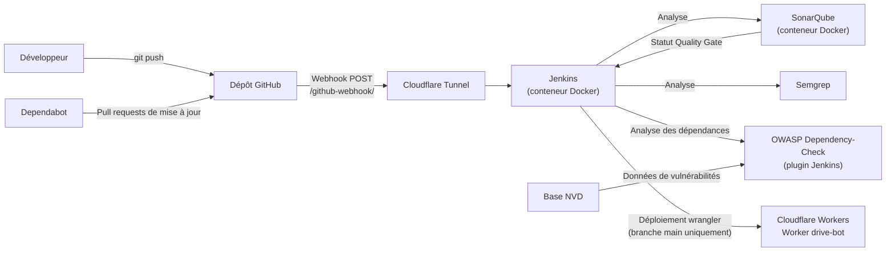

**Flux de données :**

1. Le développeur pousse un commit sur GitHub (ou Dependabot ouvre une pull request).
2. GitHub envoie une requête `POST` (JSON) à `https://jenkins.khalidlab.tech/github-webhook/`.
3. La requête traverse le **Cloudflare Tunnel** jusqu'au conteneur Jenkins : le tunnel est une connexion **sortante**, donc aucun port n'a besoin d'être ouvert en entrée sur le pare-feu de l'instance pour cela (voir la remarque sur les ports publiés au [§ 5.2](#52-provisionnement-avec-ansible)).
4. Jenkins récupère le code, installe les dépendances et lance l'analyse **SonarQube**.
5. L'étape **Quality Gate** attend le verdict calculé par SonarQube.
6. **Semgrep** analyse le code avec son jeu de règles.
7. **OWASP Dependency-Check** analyse `package-lock.json` et fait échouer le build si une vulnérabilité atteint le seuil CVSS configuré.
8. Si toutes les étapes réussissent **et que la branche est `main`**, l'application est déployée sur Cloudflare Workers.

### 3.3 Composants de l'infrastructure

| Composant | Détail observé | Source |
|---|---|---|
| Instance cloud | `notes`, Google Compute Engine, zone `us-central1-a`, x86_64 | Figure 2 |
| Ressources de la VM | 3,8 Gio de RAM, 2 Gio de swap, disque de 40 Go | Mesures du Workshop 3 (§ 8.8) |
| Système | Debian 13 « trixie » (image `debian-13-trixie-v20261014`), noyau 6.12.113 | Figures 2 et 3 |
| Provisionnement | Ansible 2.16.3, inventaire `inventory.ini`, `playbook.yml` | Figure 4, § 5.2 |
| Conteneurs | Docker ; Jenkins (`jenkins/jenkins:lts-jdk21`) ; SonarQube (`sonarqube:community`) | Playbook (§ 5.2) |
| Exposition | Cloudflare Tunnel `khalidlab-tunnel`, cloudflared 2026.10.1 | Figures 5 et 6 |
| SonarQube | Édition Community, projets `learn-actions` (production) et `learn-actions-workshop-3` (tests) | Figures 8 et 9 |
| Application | Next.js en TypeScript (≈ 1,6 k lignes de code TypeScript, CSS…) | Figure 8 |
| Déploiement | Cloudflare Workers via wrangler 4.151.1, Worker `drive-bot` | Figure 10 |
| SCA | Plugin Jenkins OWASP Dependency-Check, outil `dependency-check`, clé d'API NVD | Figures 14 à 16 |
| Mises à jour automatiques | Dependabot (écosystème `npm`) | Figures 11 à 13 |

---

## 4. Environnement et prérequis

### 4.1 Prérequis obligatoires

| Élément | Usage | Version observée |
|---|---|---|
| Compte Google Cloud | Instance qui héberge Jenkins et SonarQube | — |
| Ansible (poste de contrôle) | Installation de Docker et lancement des conteneurs | 2.16.3 |
| Accès SSH à l'instance | Exécution d'Ansible et administration | clé `ed25519`, utilisateur `sano` |
| Docker | Exécution de Jenkins et SonarQube | installé par le playbook (`docker-ce`, dépôt officiel Docker) |
| Jenkins | Orchestration du pipeline | image `jenkins/jenkins:lts-jdk21` |
| SonarQube | Analyse et Quality Gate | image `sonarqube:community` |
| Semgrep | Analyse par règles | non visible |
| Node.js | Build de l'application (outil Jenkins `node22`) | outil `node22` |
| Dépôt GitHub | Code source, webhook et Dependabot | — |
| Plugin Jenkins OWASP Dependency-Check | Analyse des dépendances | version installée via *Manage Jenkins → Plugins* |
| Clé d'API NVD | Téléchargement de la base de vulnérabilités sans limitation de débit | demandée gratuitement sur le site du NVD |

### 4.2 Prérequis optionnels (selon l'exposition et la cible de déploiement)

| Élément | Usage | Version observée |
|---|---|---|
| Domaine géré par Cloudflare | Sous-domaines `jenkins.` et `sonar.` | `khalidlab.tech` |
| cloudflared | Tunnel vers Jenkins et SonarQube | 2026.10.1 |
| Compte Cloudflare Workers + wrangler | Déploiement de l'application | wrangler 4.151.1 |

### 4.3 Vérifier l'environnement

Sur le poste de contrôle, la connectivité Ansible se vérifie avec le module `ping` (commande réellement exécutée, figure 4) :

```bash
ansible all -i inventory.ini -m ping
```

Réponse attendue : `SUCCESS` avec `"ping": "pong"` pour chaque hôte. Un `UNREACHABLE` indique un problème d'adresse, de clé SSH ou de pare-feu.

Sur l'instance, une fois provisionnée, les commandes usuelles suivantes permettent de contrôler les versions et les ressources :

```bash
docker --version
docker ps            # les conteneurs jenkins et sonarqube doivent apparaître
cloudflared --version
df -h /              # espace disque
free -h              # mémoire et swap
```

---

## 5. Installation et configuration

### 5.1 Création de l'instance Google Cloud

**Figure 2 — Instance Compute Engine `notes`**


*Explication :* l'instance `notes` est **en cours d'exécution** dans la zone `us-central1-a`, avec l'image de démarrage `debian-13-trixie-v20261014` (x86_64). Elle a été créée le 17 octobre 2026. C'est elle qui héberge l'ensemble de la chaîne d'analyse.

**Figure 3 — Connexion SSH à l'instance**


*Explication :* la connexion SSH avec l'utilisateur `sano` confirme que l'instance est joignable et tourne sous **Debian GNU/Linux** avec le noyau `6.12.113+deb13-cloud-amd64`. Cet accès est le préalable au provisionnement Ansible.

### 5.2 Provisionnement avec Ansible

Le projet Ansible contient deux fichiers : `inventory.ini` (les hôtes cibles) et `playbook.yml` (les tâches).

#### Inventaire : `inventory.ini`

```ini
[gcp]
<IP_PUBLIQUE_DE_L_INSTANCE> ansible_user=sano ansible_ssh_private_key_file=~/.ssh/id_ed25519 ansible_python_interpreter=/usr/bin/python3
```

- `[gcp]` est le groupe d'hôtes ciblé par le playbook (`hosts: gcp`) ;
- la connexion se fait en SSH avec l'utilisateur `sano` et une clé `ed25519` ;
- `ansible_python_interpreter` force l'usage de `python3`, présent par défaut sur Debian ;
- l'adresse IP publique est volontairement remplacée par un espace réservé dans ce document.

#### Playbook : `playbook.yml`

```yaml
---
- name: Install Docker, then run Jenkins and SonarQube as containers
  hosts: gcp
  become: true

  tasks:
    # ---------- Docker (installed on the VM) ----------
    - name: Install prerequisites
      apt:
        name: [ca-certificates, curl, gnupg]
        update_cache: true

    - name: Create keyrings directory
      file:
        path: /etc/apt/keyrings
        state: directory
        mode: "0755"

    - name: Add Docker GPG key
      get_url:
        url: https://download.docker.com/linux/debian/gpg
        dest: /etc/apt/keyrings/docker.asc
        mode: "0644"
        force: true

    - name: Add Docker repository
      apt_repository:
        repo: "deb [arch=amd64 signed-by=/etc/apt/keyrings/docker.asc] https://download.docker.com/linux/{{ ansible_distribution | lower }} {{ ansible_distribution_release }} stable"
        filename: docker

    - name: Install Docker
      apt:
        name:
          - docker-ce
          - docker-ce-cli
          - containerd.io
          - docker-buildx-plugin
          - docker-compose-plugin
          - python3-pip
        update_cache: true

    - name: Enable and start Docker
      service:
        name: docker
        state: started
        enabled: true

    - name: Install Docker Python SDK (for Ansible docker modules)
      pip:
        name: "docker>=7.1.0"
        extra_args: --break-system-packages

    - name: Add SSH user to docker group
      user:
        name: "{{ ansible_user }}"
        groups: docker
        append: true

    # ---------- Jenkins (container) ----------
    - name: Run Jenkins container
      community.docker.docker_container:
        name: jenkins
        image: jenkins/jenkins:lts-jdk21
        state: started
        restart_policy: unless-stopped
        user: root
        ports:
          - "8080:8080"
          - "50000:50000"
        volumes:
          - jenkins_home:/var/jenkins_home
          - /var/run/docker.sock:/var/run/docker.sock

    - name: Install Docker CLI inside the Jenkins container
      command: docker exec -u root jenkins sh -c "command -v docker || (apt-get update && (apt-get install -y docker-cli || apt-get install -y docker.io))"
      register: jenkins_docker_cli
      changed_when: "'Setting up' in jenkins_docker_cli.stdout"

    # ---------- SonarQube (container) ----------
    - name: Set vm.max_map_count for SonarQube
      sysctl:
        name: vm.max_map_count
        value: "262144"
        sysctl_set: true
        state: present

    - name: Set fs.file-max for SonarQube
      sysctl:
        name: fs.file-max
        value: "65536"
        sysctl_set: true
        state: present

    - name: Run SonarQube container
      community.docker.docker_container:
        name: sonarqube
        image: sonarqube:community
        state: started
        restart_policy: unless-stopped
        ports:
          - "9000:9000"
        volumes:
          - sonarqube_data:/opt/sonarqube/data
          - sonarqube_logs:/opt/sonarqube/logs
          - sonarqube_extensions:/opt/sonarqube/extensions
```

#### Ce que fait le playbook

| Bloc | Tâches | Rôle |
|---|---|---|
| **Docker (sur la VM)** | Prérequis, répertoire `/etc/apt/keyrings`, clé GPG et dépôt officiels Docker, installation de `docker-ce`, `docker-ce-cli`, `containerd.io`, des plugins `buildx` et `compose`, activation du service | Installer Docker depuis le dépôt officiel et le démarrer au boot |
| **SDK Python Docker** | `pip install "docker>=7.1.0"` (avec `--break-system-packages`) | Requis par les modules `community.docker` ; l'option est nécessaire sur Debian 13, dont le Python système est protégé (PEP 668) |
| **Groupe `docker`** | Ajout de l'utilisateur SSH au groupe `docker` | Permettre d'utiliser `docker` sans `sudo` (effectif à la prochaine connexion) |
| **Jenkins** | Conteneur `jenkins/jenkins:lts-jdk21`, ports `8080` (interface web) et `50000` (agents), volume `jenkins_home`, socket Docker monté | Orchestrateur CI/CD, données persistantes, accès au démon Docker de l'hôte |
| **Docker CLI dans Jenkins** | `docker exec` qui installe `docker-cli` (ou `docker.io`) si `docker` est absent | Permettre au pipeline de lancer des commandes Docker (par exemple pour exécuter Semgrep en conteneur) |
| **Paramètres noyau** | `vm.max_map_count = 262144`, `fs.file-max = 65536` | Prérequis de SonarQube (moteur de recherche embarqué), persistés par `sysctl` |
| **SonarQube** | Conteneur `sonarqube:community`, port `9000`, trois volumes (`data`, `logs`, `extensions`) | Serveur d'analyse avec données conservées au redémarrage |

Les deux conteneurs utilisent `restart_policy: unless-stopped` : ils redémarrent automatiquement après un reboot de l'instance, sauf s'ils ont été arrêtés volontairement.

#### Lancer le provisionnement

```bash
ansible all -i inventory.ini -m ping             # 1. tester la connexion
ansible-playbook -i inventory.ini playbook.yml   # 2. appliquer le playbook
```

**Figure 4 — Test de connectivité et exécution du playbook**


*Explication :* le `ping` Ansible renvoie `SUCCESS` / `pong`. Le playbook démarre ensuite la play **« Install Docker, then run Jenkins and SonarQube as containers »** : il installe Docker puis lance Jenkins et SonarQube en conteneurs. Un avertissement indique que la collection `community.docker` ne prend pas officiellement en charge **Ansible 2.16.3** ; il n'a pas empêché l'exécution visible ici, mais il signale un risque de compatibilité à corriger (voir [§ 10](#10-limites-et-recommandations)). La capture s'arrête à la tâche *Gathering Facts* : le récapitulatif final (`PLAY RECAP`) n'y figure pas.

> **Intérêt de l'approche :** l'infrastructure est décrite sous forme de code ; elle peut être reconstruite à l'identique sur une nouvelle instance.

#### Points d'attention sur ce playbook

- **Ports publiés sur toutes les interfaces.** Les mappings `"8080:8080"`, `"50000:50000"` et `"9000:9000"` exposent les services sur toutes les interfaces de la VM. Comme l'accès public passe par le Cloudflare Tunnel, il suffit de ne pas ouvrir ces ports dans le pare-feu GCP, ou de les lier à la boucle locale (`"127.0.0.1:8080:8080"`).
- **Socket Docker monté dans Jenkins, conteneur en `root`.** C'est pratique (le pipeline peut piloter Docker) mais cela donne à Jenkins un contrôle équivalent à `root` sur l'hôte. Acceptable pour un workshop, à éviter en production.
- **Tag `lts-jdk21` et `sonarqube:community`.** Ce sont des tags **mobiles** : une réexécution du playbook peut tirer une version plus récente. Pour un environnement reproductible, fixer un tag précis.
- **Tâche `docker exec`.** Elle passe par `command` : l'idempotence repose sur `command -v docker` et sur `changed_when`, pas sur un module Ansible dédié.
- **Compatibilité.** L'avertissement `community.docker` / Ansible 2.16.3 vu en figure 4 est à traiter en alignant les versions.

### 5.3 Exposition de Jenkins et SonarQube via Cloudflare Tunnel

Plutôt que d'ouvrir les ports de Jenkins et SonarQube sur Internet, l'équipe a utilisé un **Cloudflare Tunnel** : le connecteur `cloudflared`, installé sur l'instance, établit une connexion **sortante** vers Cloudflare, qui publie ensuite `jenkins.khalidlab.tech` et `sonar.khalidlab.tech` en HTTPS.

```bash
cloudflared tunnel login                  # authentification auprès de Cloudflare
cloudflared tunnel run khalidlab-tunnel   # démarrage du tunnel
```

**Figure 5 — Authentification de cloudflared**


*Explication :* après validation dans le navigateur, `cloudflared` confirme la connexion et enregistre le certificat d'origine dans `/home/sano/.cloudflared/cert.pem`. Ce fichier donne le droit de gérer les tunnels du compte : il ne doit **jamais** être versionné ni partagé.

**Figure 6 — Démarrage du tunnel `khalidlab-tunnel`**


*Explication :* le tunnel démarre (cloudflared **2026.10.1**, Go 1.27.2, linux), lit son fichier d'identifiants, génère un identifiant de connecteur et utilise le protocole **QUIC**. Le tunnel est ici lancé en arrière-plan avec `&` ; pour un fonctionnement durable (redémarrage de l'instance), il est préférable de l'installer comme service système.

### 5.4 Configuration du webhook GitHub

Dans le dépôt GitHub : **Settings → Webhooks → Add webhook**.

**Figure 7 — Webhook GitHub vers Jenkins**


*Explication :* GitHub envoie un `POST` au format `application/json` vers `https://jenkins.khalidlab.tech/github-webhook/`, point d'entrée du plugin GitHub de Jenkins. C'est ce webhook qui déclenche le pipeline à chaque push (la figure 10 confirme un build *« Started by GitHub push »*). Le champ **Secret** est vide : la signature des requêtes n'est donc pas vérifiée (voir [§ 10.4](#104-recommandations-pour-ce-projet)).

Ce même webhook sert pour toutes les branches : chaque job Jenkins ne construit que la branche déclarée dans son *Branch Specifier* (voir [§ 8.2](#82-stratégie-de-test-sur-une-branche)).

### 5.5 Configuration de Jenkins et gestion des secrets

D'après la figure 10, le job Jenkins utilise :

- un outil Node.js déclaré sous le nom **`node22`** (*Global Tool Configuration*) ;
- une intégration **SonarQube** (analyse puis attente de la Quality Gate) ;
- un identifiant **`N8N_WEBHOOK_URL`** stocké dans Jenkins et masqué dans les journaux (`****`).

Les secrets ne doivent jamais apparaître dans le code ni dans ce README. Ils sont stockés dans **Manage Jenkins → Credentials** puis injectés dans le pipeline sous forme de variables d'environnement, par exemple `${SONAR_TOKEN}` pour le jeton SonarQube ou les identifiants Cloudflare nécessaires à wrangler. Jenkins masque automatiquement leur valeur dans la console, comme le montre la figure 10. Le Workshop 3 ajoute un secret du même type, la clé d'API NVD (voir [§ 8.4](#84-owasp-dependency-check-dans-jenkins)).

---

## 6. Analyse SonarQube

### 6.1 Rôle et intégration

SonarQube analyse le code transmis par le scanner, calcule des indicateurs par **qualité logicielle** et évalue la **Quality Gate**. Dans le pipeline, l'étape *SonarQube Analysis* envoie l'analyse au serveur `sonar.khalidlab.tech`, puis l'étape *Quality Gate* attend le verdict. Le projet de production est enregistré dans SonarQube sous la clé **`learn-actions`**. La configuration du scanner se trouve dans `sonar-project.properties` :

```properties
sonar.projectKey=learn-actions
sonar.projectName=learn-actions
sonar.sources=.
sonar.exclusions=node_modules/**,.next/**,.open-next/**,.wrangler/**,.semgrep-venv/**
sonar.sourceEncoding=UTF-8
```

### 6.2 Tableau de bord du projet

**Figure 8 — Vue synthétique du projet `learn-actions`**


*Explication :* dernière analyse il y a 7 heures au moment de la capture, sur environ **1,6 k lignes de code** (TypeScript, CSS…).

| Qualité logicielle | Note | Nombre de problèmes | Lecture |
|---|---|---|---|
| Security | **C** | 1 | Un problème de sécurité ouvert (détaillé en 6.3) |
| Reliability | **C** | 8 | Défauts de fiabilité (gestion des promesses) |
| Maintainability | **A** | 1 | Un problème de maintenabilité mineur |
| Security Hotspots revus | **A** | — | Aucun hotspot en attente de revue |
| Couverture | — | 0,0 % | Aucun rapport de tests transmis à SonarQube |
| Duplications | — | 0,0 % | Pas de code dupliqué détecté |

> **Note sur le nombre de problèmes.** La vue *Issues* de la figure 9 affiche **9 issues** pour `app/page.tsx` (filtre sur les statuts *Open* et *Confirmed*), chiffre cohérent avec le résultat rapporté pour le workshop. La carte projet totalise 1 + 8 + 1 = 10 problèmes : un même problème pouvant être rattaché à plusieurs qualités logicielles, ou un problème pouvant se trouver dans un autre fichier, les deux vues ne se comparent pas directement. Les captures ne permettent pas de trancher.

### 6.3 Détail d'un problème de sécurité : règle `typescript:S2245`

**Figure 9 — Problème de sécurité sur le générateur pseudo-aléatoire**


*Explication :* SonarQube signale, ligne 33 de `app/page.tsx`, l'usage de `Math.random()` dans la fonction `uid()` (règle **`typescript:S2245`**, impact **Security / Medium**, effort estimé 10 min). Le code utilise `crypto.randomUUID()` lorsqu'il est disponible et ne retombe sur `Math.random()` + `Date.now()` qu'en solution de repli. Les identifiants générés servent à identifier des conversations (`makeChat`).

**Interprétation :** `Math.random()` n'est pas un générateur cryptographiquement sûr : ses valeurs sont prévisibles. Le risque n'existe que si l'identifiant joue un rôle de sécurité (jeton de session, secret, lien non devinable). S'il s'agit seulement d'une clé d'affichage locale, le problème peut être revu et accepté avec justification ; sinon, il faut corriger. La correction recommandée est d'utiliser l'API Web Crypto aussi dans le repli, par exemple `crypto.getRandomValues()`.

### 6.4 Problèmes de fiabilité visibles

La liste latérale de la figure 9 montre deux familles de problèmes de fiabilité dans `app/page.tsx` :

| Message SonarQube | Signification | Correction recommandée |
|---|---|---|
| *Expected the Promise rejection reason to be an Error* | Une promesse est rejetée avec une valeur qui n'est pas un objet `Error` : on perd la pile d'appels et le type d'erreur | Rejeter avec `new Error("…")` |
| *Promises must be awaited, end with a call to .catch, … or be explicitly marked as ignored with the `void` operator* | Une promesse est lancée sans que son échec soit traité : une erreur peut passer inaperçue | Ajouter `await`, un `.catch(...)`, ou `void` si l'ignorer est volontaire |

Ces problèmes relèvent de la **fiabilité** et non directement de la sécurité ; ils peuvent néanmoins masquer des erreurs à l'exécution. Il serait inexact de présenter les 9 issues comme 9 vulnérabilités : **une seule** est classée *Security* dans les captures.

### 6.5 Quality Gate

Dans le build #9 (figure 10), l'étape **Quality Gate** se termine en succès (21 s) et le pipeline poursuit jusqu'au déploiement : la Quality Gate est donc **passée**, malgré les problèmes ouverts. Cela signifie que les conditions de la Quality Gate configurée n'étaient pas enfreintes (la Quality Gate par défaut de SonarQube porte principalement sur le **nouveau code**). La définition exacte des conditions utilisées n'apparaît pas dans les captures.

### 6.6 Avertissement : base de données embarquée

La bannière de la figure 9 indique que SonarQube utilise sa **base de données embarquée**, prévue uniquement pour l'évaluation : elle ne permet ni la montée en charge, ni la mise à jour vers une nouvelle version de SonarQube, ni la migration vers un autre moteur. C'est cohérent avec le playbook, qui lance `sonarqube:community` sans base externe ; c'est acceptable pour un workshop, mais une base PostgreSQL serait nécessaire pour un usage durable.

---

## 7. Analyse Semgrep et pipeline Jenkins (Workshop 1)

### 7.1 Analyse Semgrep

**Rôle :** Semgrep analyse le code en le comparant à des **règles** décrivant des motifs dangereux (par exemple un appel à `eval` sur une entrée utilisateur). Les règles sont exprimées dans une syntaxe proche du code analysé, ce qui les rend faciles à lire et à adapter.

**Exécution dans le pipeline :** l'étape **Semgrep** du build #9 s'est terminée en succès en **15 s** (figure 10). Dans le `Jenkinsfile`, elle installe Semgrep dans un environnement virtuel Python puis lance les jeux de règles `p/default` et `p/nextjs` avec l'option `--error`, qui fait échouer l'étape dès qu'un finding est trouvé (voir [§ 8.5](#85-jenkinsfile-complet)).

**Résultat rapporté :**

| Indicateur | Valeur | Statut de la preuve |
|---|---|---|
| Règles exécutées | 214 | Rapporté dans la description du workshop |
| Fichiers analysés | 26 | Rapporté dans la description du workshop |
| Findings | 0 | Rapporté dans la description du workshop |
| Étape Jenkins *Semgrep* | Succès, 15 s | **Visible** (figure 10) |

> Aucune capture de la sortie de Semgrep n'est disponible : le détail des 214 règles, des 26 fichiers et des 0 findings n'a donc pas pu être vérifié visuellement.

**Interprétation d'un résultat à zéro finding :** cela signifie qu'**aucune des règles exécutées** n'a trouvé de correspondance dans les fichiers analysés. Cela ne signifie **pas** que l'application est sans vulnérabilité : la couverture dépend entièrement du jeu de règles. On remarque d'ailleurs que l'usage de `Math.random()` relevé par SonarQube n'a pas été signalé par Semgrep, ce qui illustre la complémentarité des deux outils.

Pour reproduire une analyse en local, la commande standard de Semgrep est la suivante :

```bash
semgrep scan --config p/default --config p/nextjs --error
```

### 7.2 Pipeline Jenkins

**Figure 10 — Exécution réussie du build #9 du job `notes`**


*Explication :* le build **#9** a été **déclenché par un push GitHub** de l'utilisateur `sanotogii` et a duré **4 min 9 s**. Toutes les étapes sont **vertes**. Ce pipeline est celui du Workshop 1, avant l'ajout du contrôle des dépendances :

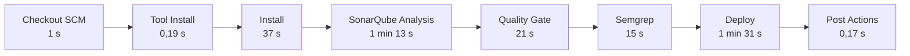

| Étape | Durée | Rôle |
|---|---|---|
| Checkout SCM | 1 s | Récupération du code depuis GitHub |
| Tool Install | 0,19 s | Mise à disposition de Node.js (`node22`) |
| Install | 37 s | Installation des dépendances npm |
| SonarQube Analysis | 1 min 13 s | Envoi de l'analyse au serveur SonarQube |
| Quality Gate | 21 s | Attente et vérification du verdict SonarQube |
| Semgrep | 15 s | Analyse par règles |
| Deploy | 1 min 31 s | Déploiement sur Cloudflare Workers |
| Post Actions | 0,17 s | Actions de fin de pipeline |

L'ordre des étapes place les **contrôles de sécurité avant le déploiement** : un échec de l'une d'elles empêche la mise en production. Le pipeline final, avec Dependency-Check, est présenté au [§ 8.6](#86-exécution-du-build-sur-workshop-3).

### 7.3 Détail de l'étape Deploy

La console de l'étape *Deploy* (figure 10) montre la séquence suivante :

1. sélection de l'outil `node22` et chargement de son environnement ;
2. contrôle de présence du secret : si `N8N_WEBHOOK_URL` est vide, le pipeline affiche *« N8N_WEBHOOK_URL credential is not configured »* et s'arrête (`exit 1`) ;
3. `npx wrangler secret put N8N_WEBHOOK_URL` : le secret est transmis au Worker **`drive-bot`** (*Success! Uploaded secret N8N_WEBHOOK_URL*) ;
4. `npm run deploy` : construction et déploiement de l'application.

La valeur du secret apparaît masquée (`****`) dans le journal : elle n'est jamais écrite en clair.

### 7.4 Comportement en cas d'échec

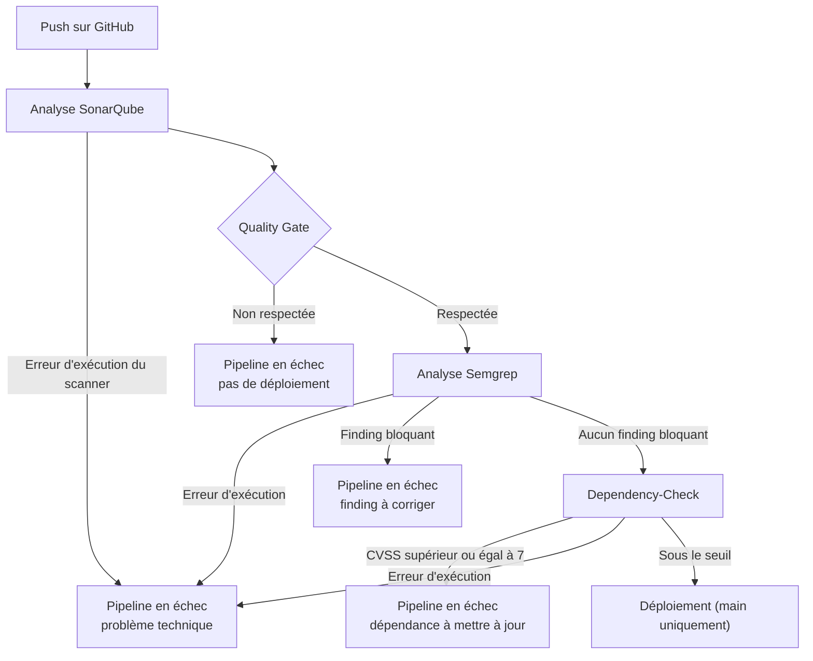

Il faut distinguer deux situations :

- **Erreur d'exécution** (serveur SonarQube injoignable, jeton invalide, Semgrep non installé, base Dependency-Check corrompue) : c'est un problème d'outillage, pas de sécurité. Le code n'a pas été évalué.
- **Résultat de sécurité** (Quality Gate non respectée, finding Semgrep bloquant, vulnérabilité de dépendance au-dessus du seuil) : l'outil a fonctionné et a trouvé un problème. Il faut corriger, ou justifier explicitement l'acceptation du risque.

---

## 8. Workshop 3, analyse des dépendances (SCA)

### 8.1 Contexte et objectif

L'énoncé du Workshop 3 (chapitre « Sécurité des dépendances et librairies (SCA) ») demande de sécuriser les dépendances d'un projet : configurer **Dependabot** pour générer automatiquement des pull requests de mise à jour, utiliser **OWASP Dependency-Check** pour détecter les vulnérabilités des bibliothèques, comprendre comment ces outils s'intègrent dans un pipeline CI/CD et corriger efficacement les vulnérabilités détectées.

L'énoncé prend l'exemple d'un projet **Maven**. Le projet de l'équipe étant une application **Next.js**, l'exercice a été adapté à l'écosystème **npm** :

| Énoncé (Maven) | Adaptation (npm) |
|---|---|
| Fichier analysé : `pom.xml` | `package-lock.json` |
| Dependabot, écosystème `maven` | Dependabot, écosystème `npm` |
| Dependency-Check, analyse des JAR | Dependency-Check, analyse de `package-lock.json` |

### 8.2 Stratégie de test sur une branche

Le pipeline de production déploie le site à chaque push sur `main`. Pour ne pas risquer la production, tout a été développé sur une branche `workshop-3` avec un job Jenkins dédié.

```bash
git checkout main
git pull
git checkout -b workshop-3
```

**Trois risques ont été identifiés et traités avant le premier build :**

| Risque | Conséquence si ignoré | Mesure prise |
|---|---|---|
| Le build de `workshop-3` exécute l'étape `Deploy` | Le Worker de production serait redéployé depuis une branche de test | `Deploy` n'a lieu que si la branche est `main` (`when { expression { ... } }`) |
| SonarQube Community ne gère pas les branches | L'analyse de `workshop-3` écraserait celle du projet `learn-actions` | Clé de projet SonarQube dépendante de la branche : `learn-actions` pour `main`, `learn-actions-workshop-3` sinon |
| Deux builds simultanés sur la même base Dependency-Check | Corruption de la base (voir [§ 8.8](#88-incident-base-de-données-corrompue)) | `disableConcurrentBuilds()` dans les options du pipeline |

**Création du job de test dans Jenkins :**

1. *Dashboard → New Item*, nom `learn-actions-workshop-3`.
2. Dans le champ *Copy from*, saisir le nom du job de production existant, puis *OK*.
3. Dans la configuration, vérifier que *Build Triggers → GitHub hook trigger for GITScm polling* est coché.
4. Dans *Pipeline → Definition : Pipeline script from SCM*, remplacer le *Branch Specifier* par `*/workshop-3`, le chemin du script restant `Jenkinsfile`.
5. *Save*.

Le webhook GitHub existant est réutilisé : un push sur `workshop-3` ne déclenche que ce job, car le job de production ne suit que `main`.

**Figure 17 — Configuration du job `learn-actions-workshop-3`**

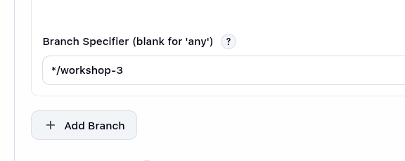

### 8.3 Dependabot

#### Configuration

Dependabot est un service de GitHub : il lit le fichier `.github/dependabot.yml` du dépôt.

```yaml
version: 2
updates:
  - package-ecosystem: "npm"
    directory: "/"
    schedule:
      interval: "weekly"
    open-pull-requests-limit: 5
    labels:
      - "dependencies"
```

| Paramètre | Valeur | Effet |
|---|---|---|
| `package-ecosystem` | `npm` | Surveille `package.json` et `package-lock.json` |
| `directory` | `/` | Fichiers à la racine du dépôt |
| `schedule.interval` | `weekly` | Vérification une fois par semaine |
| `open-pull-requests-limit` | `5` | Au plus 5 pull requests de mise à jour ouvertes en même temps |
| `labels` | `dependencies` | Étiquette ajoutée aux pull requests, pour les repérer |

#### Activation côté GitHub

Dans le dépôt : **Settings → Advanced Security** (appelé *Code security* dans certaines versions de l'interface), activer :

- *Dependency graph* ;
- *Dependabot alerts* ;
- *Dependabot security updates* ;
- *Dependabot version updates*.

**Figure 11 — Réglages Dependabot dans GitHub**

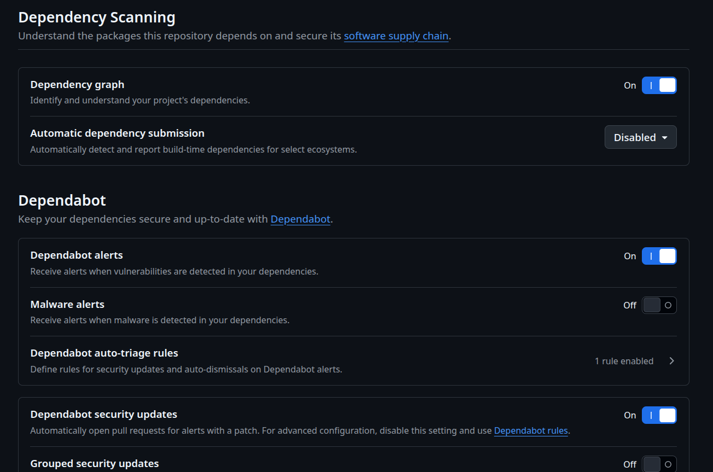

#### Limite importante : la branche par défaut

Dependabot lit sa configuration **uniquement sur la branche par défaut** (`main`). Un fichier `dependabot.yml` présent seulement sur `workshop-3` ne déclenche donc rien. La partie Dependabot ne peut être vérifiée complètement qu'après la fusion dans `main` (voir [§ 8.10](#810-mise-en-production)). Le fichier ne représente aucun risque pour la production : il ne fait qu'ouvrir des pull requests.

#### Vérification

Après la fusion : *Insights → Dependency graph → Dependabot → Check for updates* force une vérification immédiate, et les pull requests apparaissent dans l'onglet *Pull requests* avec le label `dependencies`. Chaque pull request de Dependabot déclenche le pipeline : elle ne doit être fusionnée que si le pipeline est vert.

**Figure 12 — Onglet Dependabot**

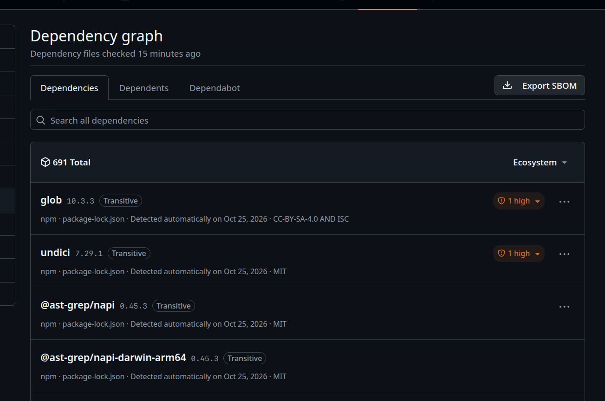

**Figure 13 — Pull requests ouvertes par Dependabot**

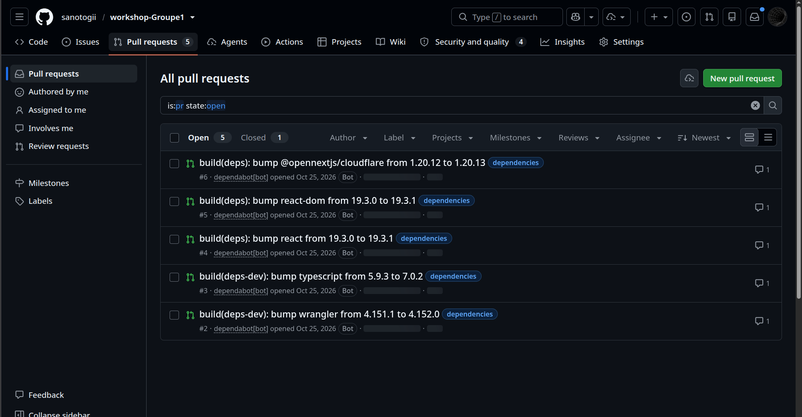

[À COMPLÉTER : indiquer ici le nombre de PR ouvertes et un exemple de paquet mis à jour.]

### 8.4 OWASP Dependency-Check dans Jenkins

#### Principe

Dependency-Check lit les dépendances de `package-lock.json`, les compare à la base de vulnérabilités du **NVD** (*National Vulnerability Database*) et attribue à chaque vulnérabilité un score **CVSS**. Le seuil de blocage retenu est **CVSS 7**, c'est-à-dire les vulnérabilités de gravité **High** et **Critical**.

#### Installation et configuration

**1. Plugin.** *Manage Jenkins → Plugins → Available plugins*, rechercher **OWASP Dependency-Check**, installer, puis redémarrer Jenkins.

**Figure 14 — Plugin installé**

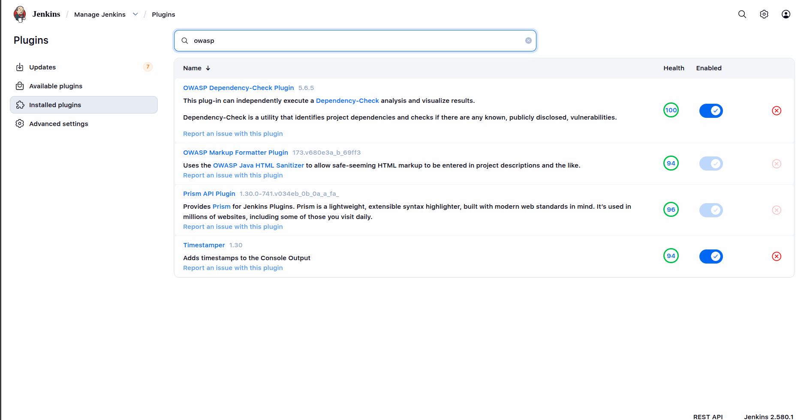

**2. Clé d'API NVD.** Sans clé, le téléchargement de la base est très lent et soumis à des limites de débit. Une clé gratuite se demande sur le site du NVD ; elle est enregistrée dans Jenkins comme secret :

*Manage Jenkins → Credentials → System → Global credentials (unrestricted) → Add Credentials*, type **Secret text**, ID **`nvd-api-key`**.

**Figure 16 — Identifiant de la clé NVD**

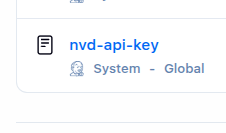

**3. Outil.** *Manage Jenkins → Tools → Dependency-Check installations → Add Dependency-Check*, nom **`dependency-check`**, cocher *Install automatically*, ajouter l'installeur *Install from github.com* et choisir la version la plus récente proposée.

#### L'étape du pipeline

```groovy
stage('OWASP Dependency-Check') {
  steps {
    dependencyCheck odcInstallation: 'dependency-check', nvdCredentialsId: 'nvd-api-key', additionalArguments: '--scan package-lock.json --format HTML --format XML --failOnCVSS 7'
  }
  post {
    always {
      dependencyCheckPublisher pattern: '**/dependency-check-report.xml'
      archiveArtifacts artifacts: 'dependency-check-report.*', allowEmptyArchive: true
    }
  }
}
```

| Élément | Rôle |
|---|---|
| `odcInstallation: 'dependency-check'` | Nom de l'outil déclaré dans *Manage Jenkins → Tools* |
| `nvdCredentialsId: 'nvd-api-key'` | Clé d'API NVD, lue depuis les credentials Jenkins (valeur masquée dans les journaux) |
| `--scan package-lock.json` | Analyse uniquement le fichier de verrouillage, qui liste toutes les dépendances directes et indirectes |
| `--format HTML --format XML` | Génère un rapport lisible (HTML) et un rapport exploitable par Jenkins (XML) |
| `--failOnCVSS 7` | Fait échouer l'étape si une vulnérabilité a un score CVSS supérieur ou égal à 7 |
| `dependencyCheckPublisher` | Affiche les résultats dans l'interface Jenkins (page *Dependency-Check Results*) |
| `post { always { ... } }` | Publie et archive les rapports même si l'étape échoue à cause du seuil |

La base de vulnérabilités est stockée par le plugin dans le dossier de l'outil, **à l'intérieur du volume `jenkins_home`**, donc conservée entre les redémarrages :

```
/var/jenkins_home/tools/org.jenkinsci.plugins.DependencyCheck.tools.DependencyCheckInstallation/dependency-check/data/
```

La **première exécution** télécharge toute la base du NVD et prend plusieurs minutes ; les suivantes ne mettent à jour que les différences.

### 8.5 Jenkinsfile complet

Voici le `Jenkinsfile` final, qui regroupe les étapes des deux workshops :

```groovy
pipeline {
  agent any

  tools { nodejs 'node22' }

  triggers { githubPush() }

  options {
    timestamps()
    timeout(time: 60, unit: 'MINUTES')
    disableConcurrentBuilds()
  }

  stages {
    stage('Install') {
      steps { sh 'npm ci' }
    }

    stage('SonarQube Analysis') {
      steps {
        script {
          def key = (env.GIT_BRANCH ==~ /(origin\/)?main/) ? 'learn-actions' : 'learn-actions-workshop-3'
          withSonarQubeEnv('sonarqube') {
            sh "${tool 'sonar-scanner'}/bin/sonar-scanner -Dsonar.projectKey=${key} -Dsonar.projectName=${key}"
          }
        }
      }
    }

    stage('Quality Gate') {
      steps {
        timeout(time: 10, unit: 'MINUTES') {
          waitForQualityGate abortPipeline: true
        }
      }
    }

    stage('Semgrep') {
      steps {
        sh '''
          python3 -m venv .semgrep-venv
          .semgrep-venv/bin/pip install --quiet semgrep
          .semgrep-venv/bin/semgrep scan \
            --config p/default --config p/nextjs \
            --metrics=off --error \
            --exclude node_modules --exclude .next \
            --exclude .open-next --exclude .semgrep-venv \
            --exclude .github .
        '''
      }
    }

    stage('OWASP Dependency-Check') {
      steps {
        dependencyCheck odcInstallation: 'dependency-check', nvdCredentialsId: 'nvd-api-key', additionalArguments: '--scan package-lock.json --format HTML --format XML --failOnCVSS 7'
      }
      post {
        always {
          dependencyCheckPublisher pattern: '**/dependency-check-report.xml'
          archiveArtifacts artifacts: 'dependency-check-report.*', allowEmptyArchive: true
        }
      }
    }

    stage('Deploy') {
      when { expression { env.GIT_BRANCH ==~ /(origin\/)?main/ } }
      steps {
        withCredentials([
          string(credentialsId: 'cloudflare-api-token', variable: 'CLOUDFLARE_API_TOKEN'),
          string(credentialsId: 'cloudflare-account-id', variable: 'CLOUDFLARE_ACCOUNT_ID'),
          string(credentialsId: 'n8n-webhook-url', variable: 'N8N_WEBHOOK_URL')
        ]) {
          sh '''
            if [ -z "$N8N_WEBHOOK_URL" ]; then
              echo "N8N_WEBHOOK_URL credential is not configured"
              exit 1
            fi
            printf '%s' "$N8N_WEBHOOK_URL" | npx wrangler secret put N8N_WEBHOOK_URL
            npm run deploy
          '''
        }
      }
    }
  }

  post {
    success { echo 'pipeline OK' }
    failure { echo 'pipeline failed, check the stage logs' }
  }
}
```

**Modifications par rapport au pipeline du Workshop 1 :**

| Modification | Raison |
|---|---|
| Timeout global porté de 20 à 60 minutes | Le premier téléchargement de la base NVD dure environ 10 minutes |
| `disableConcurrentBuilds()` | Empêche deux builds de modifier la base Dependency-Check en même temps |
| Clé de projet SonarQube selon la branche | Isole les analyses de test de celles de production |
| Nouvelle étape `OWASP Dependency-Check` | Contrôle des dépendances, bloquant à partir de CVSS 7 |
| `when` sur l'étape `Deploy` | Seule la branche `main` peut déployer |

### 8.6 Exécution du build sur workshop-3

**Figure 18 — Build #2 du job `learn-actions-workshop-3`**

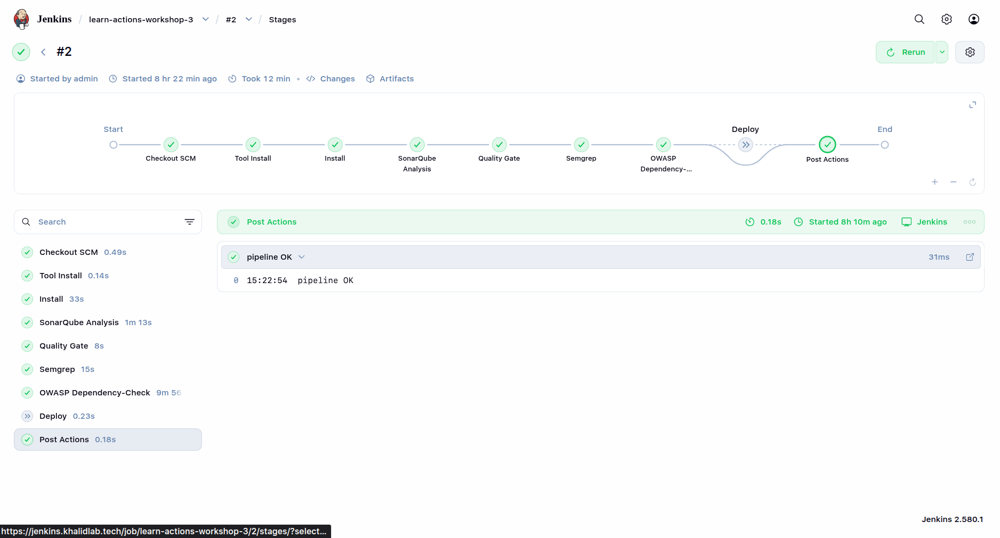

*Explication :* le build **#2** se termine en succès. Les étapes se sont déroulées ainsi :

| Étape | Durée | Remarque |
|---|---|---|
| Checkout SCM | 0,49 s | |
| Tool Install | 0,14 s | |
| Install | 33 s | `npm ci` : 623 paquets ajoutés, 624 audités |
| SonarQube Analysis | 1 min 13 s | Projet `learn-actions-workshop-3` |
| Quality Gate | 8 s | |
| Semgrep | 15 s | |
| OWASP Dependency-Check | 9 min 56 s | Première exécution : inclut le téléchargement de la base NVD (analyse 9 min 52 s, publication du rapport 4 s) |
| Deploy | 0,23 s | **Ignoré** : la branche n'est pas `main` |
| Post Actions | 0,18 s | |

L'étape `Deploy` apparaît en pointillés : c'est le comportement voulu, qui garantit qu'un build de test ne touche pas la production.

[À COMPLÉTER : durée de l'étape Dependency-Check sur un build suivant, une fois la base en cache.]

### 8.7 Lecture du rapport Dependency-Check

Les rapports sont archivés avec le build (`dependency-check-report.html` et `dependency-check-report.xml`) et le plugin ajoute une page **Dependency-Check Results** dans le menu du build.

**Figure 19 — Page *Dependency-Check Results***

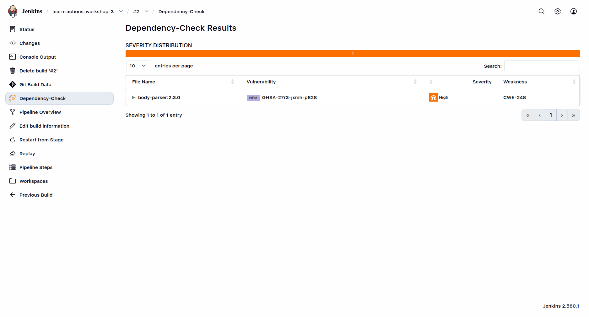

**Figure 20 — Rapport HTML**

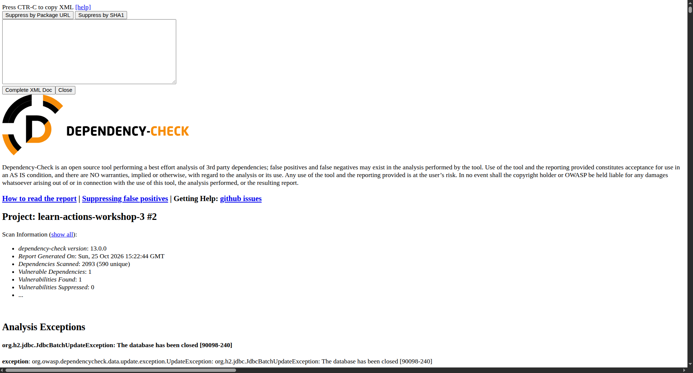


### 8.8 Mise en production

Une fois le build de `workshop-3` vert et le rapport vérifié, la branche est fusionnée dans `main`.

**Vérification avant fusion :**

```bash
git diff main..workshop-3 --stat
```

Seuls `Jenkinsfile` et `.github/dependabot.yml` doivent différer. Si `package.json` ou `package-lock.json` apparaissent, ce sont des restes de test à retirer.

**Fusion en local :**

```bash
git checkout main
git pull
git merge workshop-3
git push
```

Une pull request GitHub (*Pull requests → New pull request*, base `main`, compare `workshop-3`) est une alternative équivalente, qui laisse en plus une trace de revue.

**Après la fusion :**

1. Désactiver le job de test (*learn-actions-workshop-3 → Disable Project*) pour qu'il ne s'exécute plus en parallèle du job de production sur la même base Dependency-Check.
2. Laisser le push sur `main` déclencher le build de production, sans lancement manuel.
3. Vérifier dans ce build : le projet SonarQube utilisé est `learn-actions`, l'étape Dependency-Check est verte, et l'étape `Deploy` **s'exécute** (elle n'est plus ignorée).
4. Dependabot, dont la configuration est désormais sur la branche par défaut, commence à ouvrir ses pull requests.

**Conséquence à connaître :** la production est désormais protégée par le seuil CVSS 7. Si une dépendance contient une vulnérabilité High ou Critical, le build échoue et `Deploy` ne s'exécute pas. La résolution passe par la mise à jour du paquet nommé dans le rapport, par exemple via une pull request de Dependabot.

---

## 9. Résultats et comparaison

### 9.1 Synthèse

| Outil | Résultat observé | Action menée | Statut final |
|---|---|---|---|
| SonarQube | 9 issues sur `app/page.tsx` ; carte projet : Security C (1), Reliability C (8), Maintainability A (1) | Aucune correction documentée | Problèmes toujours ouverts au moment des captures |
| Quality Gate | Étape en succès (21 s sur le build #9, 8 s sur le build #2 de `workshop-3`) | — | **Passée** |
| Semgrep | 214 règles, 26 fichiers, 0 finding (**rapporté**) | Aucune correction nécessaire | Étape en succès (15 s) |
| OWASP Dependency-Check | Étape en succès sur `workshop-3` (build #2) avec le seuil CVSS 7 ; [À COMPLÉTER : nombre de vulnérabilités du rapport] | [À COMPLÉTER] | Étape en succès (9 min 56 s, première exécution) |
| Dependabot | Configuration `npm`, vérification hebdomadaire, 5 PR maximum | Activation des options GitHub, fichier fusionné dans `main` | [À COMPLÉTER : PR ouvertes] |
| Jenkins | Build #9 (Workshop 1) et build #2 de `workshop-3` (Workshop 3) | — | **Toutes les étapes vertes** ; `Deploy` ignoré sur `workshop-3` |

### 9.2 Problèmes SonarQube identifiés

| Fichier | Règle / message | Qualité | Sévérité | Cause | Correction recommandée | Retest |
|---|---|---|---|---|---|---|
| `app/page.tsx` L33 | `typescript:S2245` — PRNG non sûr | Security | Medium | `Math.random()` en repli de `crypto.randomUUID()` | `crypto.getRandomValues()`, ou revue justifiée si non sensible | Non effectué |
| `app/page.tsx` | *Expected the Promise rejection reason to be an Error* | Reliability | non visible | Rejet de promesse sans objet `Error` | `reject(new Error(...))` | Non effectué |
| `app/page.tsx` | *Promises must be awaited…* | Reliability | non visible | Promesse non attendue ni traitée | `await`, `.catch()` ou `void` | Non effectué |

Les captures n'affichent pas les 9 issues individuellement ; seules ces trois familles sont visibles.

### 9.3 Comparaison des outils sur ce projet

| Critère | SonarQube | Semgrep | Dependency-Check | Dependabot |
|---|---|---|---|---|
| Ce qui est analysé | Code de l'équipe | Code de l'équipe | Bibliothèques tierces | Bibliothèques tierces |
| Type de contrôle | SAST (qualité et sécurité) | SAST (sécurité, par règles) | SCA (CVE connues) | SCA (mises à jour) |
| Nature de la sortie | Issues, notes, Quality Gate | Findings par règle | Vulnérabilités avec score CVSS | Pull requests et alertes |
| Bloque le pipeline | Via la Quality Gate | Via `--error` | Via `--failOnCVSS 7` | Non (hors pipeline) |
| Corrige automatiquement | Non | Non | Non | Oui, par pull request |
| Durée dans le pipeline | 1 min 13 s + 8 à 21 s | 15 s | 9 min 56 s (1re exécution) | Hors pipeline |
| Problèmes signalés | 9 sur `app/page.tsx` | 0 (rapporté) | [À COMPLÉTER] | [À COMPLÉTER] |

Les quatre outils ne voient pas les mêmes choses : SonarQube a signalé l'usage de `Math.random()` que Semgrep n'a pas relevé ; ni l'un ni l'autre ne regardent les dépendances, ce que couvrent Dependency-Check et Dependabot. Ensemble, ils couvrent le code écrit par l'équipe **et** le code importé.

---

## 10. Limites et recommandations

### 10.1 Limites du SAST

- **Faux positifs** : un problème signalé n'est pas forcément exploitable (exemple : S2245 si l'identifiant n'a aucun rôle de sécurité). Chaque résultat demande une revue humaine.
- **Faux négatifs** : un outil ne trouve que ce que ses règles décrivent. Zéro finding ne signifie pas zéro vulnérabilité.
- **Pas d'exécution** : l'analyse statique ne voit ni la configuration réelle en production, ni les comportements à l'exécution, ni les failles de logique métier.
- **Dépendances non couvertes** : les vulnérabilités des bibliothèques npm échappent au SAST ; elles relèvent de l'analyse de composition (SCA), traitée par le Workshop 3 (voir [§ 8](#8-workshop-3-analyse-des-dépendances-sca)).

### 10.2 Limites du SCA

- **Vulnérabilités connues seulement** : Dependency-Check ne détecte que les CVE déjà publiées. Une faille non divulguée, ou une bibliothèque malveillante sans CVE, passe inaperçue.
- **Faux positifs d'identification** : l'association entre un paquet et une CVE repose sur des identifiants (CPE) parfois approximatifs ; un finding peut concerner un autre produit homonyme.
- **Gravité théorique** : le score CVSS ne tient pas compte de l'usage réel. Une vulnérabilité dans une dépendance de développement ou dans une fonction jamais appelée est moins critique que son score ne l'indique.
- **Dépendance au NVD** : le temps de mise à jour et la fiabilité dépendent d'un service externe et d'une clé d'API.
- **Écarts entre outils** : `npm audit` et Dependency-Check ne s'appuient pas sur les mêmes sources et peuvent donner des résultats différents.
- **Dependabot** : il ne lit sa configuration que sur la branche par défaut, et ses pull requests ne doivent être fusionnées qu'après un pipeline vert, sous peine d'introduire une régression.
- **Coût en temps et en mémoire** : la première exécution de Dependency-Check dure près de 10 minutes et la VM (3,8 Gio de RAM) héberge aussi Jenkins et SonarQube.

### 10.3 Limites propres aux workshops

- La **Quality Gate est passée alors que des problèmes restent ouverts** : une Quality Gate passée ne prouve pas que l'application est sûre, seulement qu'elle respecte les conditions configurées.
- La **couverture de tests est de 0 %** : aucune métrique de test n'alimente l'analyse.
- SonarQube utilise la **base de données embarquée**, non adaptée à un usage durable.
- Le résultat **Semgrep n'est pas illustré** par une capture de sa sortie.
- **Aucune correction ni nouvelle analyse** n'est documentée après la détection des problèmes SonarQube.
- La compatibilité **`community.docker` / Ansible 2.16.3** est signalée comme non supportée.
- **Jenkins tourne en `root` avec le socket Docker monté** et les ports `8080`, `50000` et `9000` sont publiés sur toutes les interfaces de la VM (voir [§ 5.2](#52-provisionnement-avec-ansible)).
- Les **images Docker utilisent des tags mobiles** (`lts-jdk21`, `community`) : l'environnement n'est pas strictement reproductible dans le temps.
- La **base Dependency-Check est partagée** entre tous les jobs : `disableConcurrentBuilds()` protège un job contre lui-même, mais pas deux jobs différents qui s'exécuteraient en même temps.
- Le **job de test et le job de production** coexistent sur la même VM : le job de test doit être désactivé après la fusion.

### 10.4 Recommandations pour ce projet

1. **Définir un secret sur le webhook GitHub** et le renseigner dans Jenkins, afin que seules les requêtes signées par GitHub déclenchent un build.
2. **Corriger S2245** avec `crypto.getRandomValues()`, ou marquer le problème comme revu en documentant pourquoi il est sans risque.
3. **Corriger les problèmes de fiabilité** sur les promesses, puis relancer le pipeline pour vérifier leur disparition.
4. **Renforcer la Quality Gate**, par exemple en exigeant une note de sécurité A.
5. **Publier le rapport Semgrep** (format SARIF ou JSON) comme artefact Jenkins, comme c'est déjà fait pour Dependency-Check.
6. **Traiter les vulnérabilités du rapport Dependency-Check** : mettre à jour les paquets concernés (idéalement via les pull requests de Dependabot), relancer le pipeline et documenter les risques acceptés.
7. **Envisager de passer Dependency-Check en exécution planifiée** (par exemple une fois par nuit) si la durée du pipeline devient gênante, tout en gardant `npm audit` à chaque build.
8. **Ajouter des tests dynamiques (DAST)** pour couvrir ce que l'analyse statique ne voit pas.
9. **Migrer SonarQube vers PostgreSQL** et **installer cloudflared comme service** plutôt qu'en arrière-plan.
10. **Aligner les versions** d'Ansible et de la collection `community.docker`.
11. **Lier les ports publiés à `127.0.0.1`** dans le playbook (`"127.0.0.1:8080:8080"`, `"127.0.0.1:9000:9000"`) et **fixer des tags d'image précis** pour Jenkins et SonarQube.
12. **Augmenter les ressources de la VM** (ou ajouter du swap) si Dependency-Check ou SonarQube sont interrompus par manque de mémoire.
13. **Ne fusionner une pull request de Dependabot qu'après un pipeline vert**, et activer la protection de la branche `main` pour l'imposer.
14. **Masquer les adresses IP publiques** visibles dans les captures avant une publication large du dépôt.

---

## 11. Conclusion

Ces deux workshops ont permis de construire une chaîne de sécurité automatisée de bout en bout. L'infrastructure a été provisionnée **sous forme de code** avec Ansible (un inventaire et un playbook qui installent Docker puis lancent Jenkins et SonarQube) sur une instance Google Cloud ; Jenkins et SonarQube y tournent en conteneurs Docker et sont exposés de manière sécurisée par un **Cloudflare Tunnel**. Un **webhook GitHub** déclenche le pipeline à chaque push, et Jenkins enchaîne installation, **analyse SonarQube**, **Quality Gate**, **analyse Semgrep**, **contrôle des dépendances avec OWASP Dependency-Check** et **déploiement** sur Cloudflare Workers.

Le Workshop 1 a montré la **complémentarité des deux outils d'analyse statique** : SonarQube a relevé 9 problèmes dans `app/page.tsx`, dont un problème de sécurité (générateur pseudo-aléatoire non cryptographique) et plusieurs problèmes de fiabilité liés aux promesses, tandis que Semgrep n'a rapporté aucun finding avec ses 214 règles.

Le Workshop 3 a ajouté la dimension des **bibliothèques tierces**, que l'analyse statique ne couvre pas. Dependency-Check bloque désormais le déploiement à partir d'un score CVSS de 7, et Dependabot propose les mises à jour sous forme de pull requests qui repassent par le pipeline. La démarche a aussi été un exercice de **changement maîtrisé** : le nouveau pipeline a été développé sur une branche `workshop-3` avec un job dédié, en neutralisant les risques pour la production (déploiement limité à `main`, projet SonarQube séparé, builds non concurrents) avant la fusion. Un incident de base de données corrompue pendant le premier téléchargement de la base du NVD a été diagnostiqué et résolu, puis prévenu par la désactivation des builds concurrents.

Ces résultats doivent cependant être lus avec recul : les problèmes SonarQube n'ont pas encore été corrigés ni retestés, et une Quality Gate passée, un scan à zéro finding ou un seuil CVSS respecté ne garantissent pas l'absence de vulnérabilité. Les prochaines étapes naturelles sont la correction des problèmes identifiés, le traitement des vulnérabilités du rapport Dependency-Check, le durcissement de la Quality Gate, du webhook et de la configuration Docker, puis l'ajout de tests dynamiques pour couvrir ce que l'analyse statique et l'analyse de composition ne voient pas.

---

## 12. Références

- SonarQube — documentation officielle : https://docs.sonarsource.com/sonarqube-server/
- SonarQube — Quality Gates : https://docs.sonarsource.com/sonarqube-server/latest/instance-administration/analysis-functions/quality-gates/
- SonarQube — intégration Jenkins : https://docs.sonarsource.com/sonarqube-server/latest/analyzing-source-code/ci-integration/jenkins-integration/global-setup/
- Règle SonarQube S2245 (PRNG) : https://rules.sonarsource.com/typescript/RSPEC-2245/
- Semgrep — documentation : https://semgrep.dev/docs/
- Semgrep — référence CLI : https://semgrep.dev/docs/cli-reference
- OWASP Dependency-Check — documentation : https://owasp.org/www-project-dependency-check/
- OWASP Dependency-Check — arguments de la ligne de commande : https://jeremylong.github.io/DependencyCheck/dependency-check-cli/arguments.html
- Plugin Jenkins OWASP Dependency-Check : https://plugins.jenkins.io/dependency-check-jenkins-plugin/
- NVD — demande de clé d'API : https://nvd.nist.gov/developers/request-an-api-key
- Dependabot — options du fichier `dependabot.yml` : https://docs.github.com/en/code-security/dependabot/working-with-dependabot/dependabot-options-reference
- Dependabot — mises à jour de version : https://docs.github.com/en/code-security/dependabot/dependabot-version-updates
- npm — `npm audit` : https://docs.npmjs.com/cli/commands/npm-audit
- FIRST — système de score CVSS : https://www.first.org/cvss/
- Jenkins — Pipeline : https://www.jenkins.io/doc/book/pipeline/
- Jenkins — gestion des credentials : https://www.jenkins.io/doc/book/using/using-credentials/
- GitHub — webhooks : https://docs.github.com/en/webhooks
- GitHub — validation des livraisons de webhook : https://docs.github.com/en/webhooks/using-webhooks/validating-webhook-deliveries
- Ansible — documentation : https://docs.ansible.com/
- Ansible — collection `community.docker` : https://docs.ansible.com/ansible/latest/collections/community/docker/
- Docker — installation sur Debian : https://docs.docker.com/engine/install/debian/
- SonarQube — prérequis système (`vm.max_map_count`) : https://docs.sonarsource.com/sonarqube-server/latest/setup-and-upgrade/pre-installation/linux/
- Cloudflare Tunnel : https://developers.cloudflare.com/cloudflare-one/connections/connect-networks/
- Cloudflare Workers — wrangler : https://developers.cloudflare.com/workers/wrangler/
- OWASP — Static Code Analysis : https://owasp.org/www-community/controls/Static_Code_Analysis
- Diagrammes Mermaid sur GitHub : https://docs.github.com/en/get-started/writing-on-github/working-with-advanced-formatting/creating-diagrams